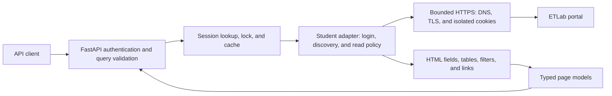

# Contributing and verification

Start with [getting started](getting-started.md) to prepare Python 3.12 or newer and a virtual environment. You can run the deterministic test suite without a student account or `.env`. The [documentation index](README.md) and [usage guide](usage.md) explain the public behavior an implementation must preserve.

## Architecture and request flow

The application separates destination-safe HTTP retrieval, student sessions/cache, portal-specific discovery/parsing, normalized page models, and FastAPI routes. Keep these boundaries when adding an institution variant. A route should not contain HTML scraping logic, and an adapter should not decide API authentication policy.



A personal read authenticates the deployment bearer token, creates a lazy student session, and logs in on the first portal operation. Multi-user session creation first authenticates the operator token, then logs in with the submitted student credentials and returns a new bearer token. The session service owns expiry, per-session synchronization, and parsed-result caches. The adapter discovers reviewed routes and filters; the upstream client enforces safe destinations and response bounds. The route serializes the parsed page and applies local pagination. Attachment bodies bypass the parsed-page cache.

| Module | Responsibility |
| --- | --- |
| [`app.py`](../src/etlab_api/app.py) | Application factory/lifespan, bearer authorization, routes, query validation, pagination, response headers, and safe errors. |
| [`settings.py`](../src/etlab_api/settings.py), [`cli.py`](../src/etlab_api/cli.py) | Validated settings and the `token`, `check`, and single-worker `serve` commands. |
| [`sessions.py`](../src/etlab_api/sessions.py) | Adapter protocol, isolated in-memory sessions, token hashes, cache bounds, expiry, cleanup, and login admission. |
| [`upstream.py`](../src/etlab_api/upstream.py) | Allowlisted origins, public DNS validation/socket pinning, TLS, isolated cookie jars, redirects, operation deadlines, and body limits. |
| [`adapters/student.py`](../src/etlab_api/adapters/student.py) | Observed login controls, resource discovery, safe GET forms, resource-specific link ownership, and attachments. |
| [`adapters/parsing.py`](../src/etlab_api/adapters/parsing.py) | Original label/value extraction, merged/duplicate table headings, text, and safe filter descriptors. |
| [`models.py`](../src/etlab_api/models.py), [`errors.py`](../src/etlab_api/errors.py) | Public typed contracts and stable safe failure codes. |

There is no database, shared session store, background academic scrape, or MCP server. The [MCP document](mcp.md) describes future integration, rather than an implemented entry point.

## Local checks

```sh
python -m pip install -e '.[dev]'
python -m pytest -m 'not live' -q
python -m ruff check .
python -m mypy src/etlab_api
python -m pip wheel --no-deps . -w /tmp/etlab-api-wheels
```

Installation and the wheel's isolated build setup can download dependencies. Once the tools are installed, tests, lint, and type checks run without portal access. For an offline wheel build, first ensure the selected environment already contains `setuptools>=75` and `wheel`; then use:

```sh
python -m pip wheel --no-deps --no-build-isolation --no-index . -w /tmp/etlab-api-wheels
```

If preparing that environment while online, install the build tools with `python -m pip install 'setuptools>=75' wheel`. The offline command deliberately fails rather than downloading missing build dependencies. `/tmp/etlab-api-wheels` is a POSIX output path; choose an equivalent temporary directory on another platform.

CI runs deterministic/mocked tests, documentation links and example-client checks, linting, strict types, distribution building, and container checks. Container smoke checks exercise startup, health, documentation, and authorization without a student login. They do not establish an institution's compatibility. Do not add real credentials to CI.

Always use `-m 'not live'` for the ordinary suite. Live tests are excluded by that command and additionally require explicit `ETLAB_LIVE_TESTS=1` opt-in even if `.env` exists. Mocked API/session tests construct settings with `_env_file=None` and use synthetic portal responses.

For a packaging check, install a newly built wheel into a separate environment and run `etlab-api --help` and `etlab-api check` from a temporary directory with explicit synthetic multi-user settings. Do not use the checkout's private `.env`. A check using shared installed dependencies validates package/entrypoint behavior, while a clean isolated dependency installation additionally verifies dependency resolution; report which one was performed.

When editing guides, update their relative links and headings together. Runnable examples must use the documented bearer-token roles, handle safe error codes, and clean up multi-user sessions. Test their request paths against mocked responses, including cleanup after a read fails; a syntax-only check is insufficient for those examples.

Check the public HTTP routes and unauthenticated data boundary of a running local server with:

```bash
python scripts/smoke_api.py
```

Use `--api-url https://your-api.example` for a hosted service. The script checks health, Swagger/ReDoc/schema responses, and an unauthenticated profile rejection; it uses no token or student credentials and does not contact ETLab through a data read. Run it with the default enabled documentation routes. HTTP checks establish serving behavior rather than visual browser rendering or successful student authentication.

## Adding a layout variant

1. Inspect the authorized student's actual login flow, navigation, filters, detail pages, and files. Preserve the selected named Login button and its value alongside the credential/hidden fields; an empty button value can still be necessary for server validation. First determine whether a read-only JSON response exists; otherwise inspect the returned HTML. Do not guess hidden endpoints or reconstruct data from a weekly recurrence or assumed semester structure.
2. Extend the adapter's identified read routes and safe filter rules. Follow links/forms observed in that session, including actual resource IDs and hidden filter fields. Keep write actions denied. If the login requires an interactive challenge, expose the challenge requirement.
3. Reuse the shared upstream client for all requests. Do not create a requests/httpx client that bypasses hostname/IP validation, TLS verification, cookie isolation, bounds, or redirect checks.
4. Return `AcademicPage` with original visible labels and values. Use fields for label/value data, tables for tabular records, text for notices, and registered opaque link IDs for read details/files. Preserve merged/duplicate headers deterministically; do not silently drop unknown academic columns. Filters must identify the exact control name and `input_type`; offer select options and validate free-input values without exposing credentials/actions.
5. Report unavailable modules accurately. A login page returned as HTTP 200 means authentication expired, not an empty academic page. A changed/unknown layout is a parsing failure, not `empty=true`.
6. Add synthetic or thoroughly sanitized fixtures and meaningful tests for the observed variation. Update the compatibility matrix only for the scenario actually validated.

See the `Adapter` protocol in `src/etlab_api/sessions.py` for the integration contract: `login`, `capabilities`, `read`, `download`, and `close`. Adapter factories receive an institution URL and validated settings. Resource/detail cache keys and per-user locking are managed by the session service.

## Fixture sanitation

Prefer synthetic HTML that reproduces the structure without personal data. If a capture is necessary, remove login values, CSRF/session tokens, student names/identifiers, phone/email/address data, grades/attendance, and private URLs/documents. Replace values while retaining structural details such as table spans, form field names, and read-route patterns. Inspect the final file manually before adding it.

Test at least login success/failure/challenge, navigation discovery, unknown modules, empty rows, merged table headers, profile label/value extraction, select options, safe/unsafe filter forms, valid/invalid dates and numbers, text limits, matched-form default preservation, resource-specific detail IDs, attachment ownership, approved/denied external file hosts, descriptor-cap eviction, same-account reauthentication retries, redirects, and changed layouts. Multi-user tests should prove that the same link/attachment ID is rejected in another session, including another institution.

## Live verification

Live verification is separate from routine checks. Only run it for an account whose owner has authorized the reads. Prepare the private `.env` using the [setup guide](getting-started.md), with a generated `API_TOKEN`, `ETLAB_BASE_URL`, and authorized `ETLAB_USERNAME`/`ETLAB_PASSWORD`; preserve any existing configuration rather than overwriting it. The live harness explicitly uses personal mode even if the deployment normally uses multi-user mode:

```sh
ETLAB_LIVE_TESTS=1 python -m pytest -m live -q
```

The harness logs in through the real adapter, checks capabilities, reads exposed core resources, and validates API structure/cache behavior. It does not submit academic actions, download every file, save response bodies, print student fields, or certify unvisited detail pages. An automatic smoke test does not replace comparing a representative response with the portal UI.

The harness calls the API in process using asynchronous ASGI transport and runs application lifespan cleanup. Its ETLab requests are real outbound HTTPS when opted in; it does not test a bound local TCP server or browser rendering. A failed login/capability check reports only the HTTP status and a safe machine code.

The default core resources are `profile,dashboard,semesters,subjects,timetable,attendance,results,assessments`; the harness reads the discovered subset and fails if none is discovered. Select a different set using the test-only environment variable `ETLAB_LIVE_RESOURCES`:

```sh
ETLAB_LIVE_TESTS=1 ETLAB_LIVE_RESOURCES=profile,attendance python -m pytest -m live -q
```

`ETLAB_LIVE_TESTS` and `ETLAB_LIVE_RESOURCES` are shell/test controls, not application configuration settings. Avoid verbose local-variable/debug logging during live tests. These tests require real outbound HTTPS/DNS access to the college; an offline or restricted environment can validate fixtures but cannot establish live compatibility.

For manual validation, compare visible totals/labels and representative table rows, check current and previous semesters when available, follow one permitted detail link, and download one expected small attachment. Record pass/fail and the reason without recording the student's values. Cover secondary modules only when the account exposes them.

Live tests should fail on bad credentials, challenges, core parser breakage, or upstream access failures. An unavailable optional module is not automatically a parser failure. Use ordinary tests for deterministic security and expiry checks; do not weaken bounds to accommodate a live portal problem.

## Before publishing changes

Check source and fixtures for credentials and private data, run the checks, and distinguish automated fixture evidence from authenticated live evidence in the change description. Document any new settings or response contract changes. Never publish a raw HAR, `.env`, or upstream cookies.

Keep commits focused: onboarding/configuration, usage/examples, operations, and verification can be reviewed independently. Update the dated [verification record](verification.md) only with checks actually observed, and preserve its limits around hosted student reads, alternate institutions, filters, and linked workflows. Use [troubleshooting](troubleshooting.md) when a failure belongs to configuration or upstream availability rather than an adapter regression.
